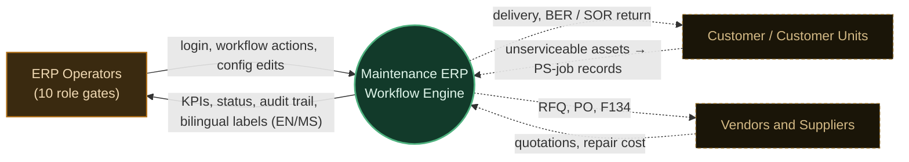
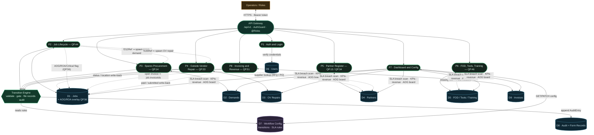

# Maintenance ERP — Data Flow Diagram (DFD)

Data flow across the running system, derived from the current source (`apps/api`, `apps/web`).
Traceable to spec **CO-RFP-IT-001**. Notation: Yourdon/DeMarco DFD — processes are NestJS
feature modules, data stores are `StoreService` collections.

- **`apps/api`** — NestJS 11, REST under `/api/v1`, the config-driven workflow engine.
- **`apps/web`** — Next.js 16 / React 19, client-side pages that render from `GET /config`.
- **Store** — `StoreService`, a PostgreSQL-backed aggregate store reached through Prisma.

The defining characteristic: statuses, transitions, role gates, mandatory fields and SLA timers are
**data, not code** (`common/workflow-config.ts`). The engine enforces them and the UI renders from them.

---

## Level 0 — Context Diagram

The system as a single process against its external entities. Solid flows are live interactions
(human operators over HTTP); dashed flows are actors modelled *as data* — the Customer customer and the
vendor/supplier partners exist as records, not live integrations.

---

## Level 1 — Process & Data Store Decomposition

Operators reach the API gateway (`/api/v1`, AuthGuard + `@Roles`); each domain process routes state
changes through the shared **Transition Engine**, which validates the legal from→to transition,
enforces role gates and mandatory form fields against the **Workflow Config**, files form-numbered
fields into the entity's records register, then appends an audit entry. Highlighted (dashed) edges are
the cross-module spawns and write-backs that make **Jobs** the spine.

### Legend

| Glyph | DFD element | Maps to |
| --- | --- | --- |
| Amber | External entity | Operators (10 role gates) over HTTP; customers & vendors dashed (modelled as data) |
| Green | Process | A NestJS feature module (controller → service), citing its source quality procedure (QP.xx) |
| Blue | Data store | An aggregate in `StoreService`, persisted as one or more PostgreSQL tables via Prisma |
| Violet | Config & engine | Transition rules + SLA timers are data — the engine enforces, the UI renders from them |

---

## Key cross-module data flows

The flows that couple the modules — where one process's transition creates or mutates another's
records (the dashed edges in Level 1).

| Trigger | Ref | Data flow |
| --- | --- | --- |
| Job → Spares | `f212Ref` | Job transition to `AWAITING_SPARE` spawns a Demand; linked via `job.demandIds`. |
| Job → OV Repair | `f135Ref` | Job transition to `REC_OV` spawns an OvRepair; linked via `job.ovId`. |
| OV → Job | write-back | OV milestones mirror into `job.audit`; updates `job.location` (VENDOR/HQ); `REJECTED` closes the job. |
| Demand → Partner | supplier | RFQ/PO reads the Partners register; enforces min-3-quotations and that the chosen supplier has a quote on file. |
| OV → Partner | vendor | Resolves `vendorId → vendorName` from registered sub-contractors. |
| Tool → FOD | `MISSING` | A shadow-board tool marked `MISSING` auto-escalates into a FOD incident (QP.38 → QP.46). |
| Job → Invoice | `job.invoiceIds` | Billing opens an Invoice against a serviceable job in one of four QP.51 streams; the engine auto-adds 6% GST and enforces the correctness gate before submission to CPU (Finance). |
| Invoice → Job | write-back | Invoice `SUBMITTED` / `PAID` milestones mirror into `job.audit`; `Payment.outstanding` drives the revenue KPI. |
| Job ⟲ Priority | `job.priority` | Any open job can be flagged AOG/ROA/Critical (QP.56); the COL overlay (status, qty, dates, route, suffix-K) expedites the applicable repair route and closes on delivery/downgrade. |
| All → Dashboard | SLA scan | KPIs scan Jobs/Demands/OV/Invoice/FOD pools against `SLA_RULES` for breaches & ageing, sum revenue/GST/outstanding, and surface the open AOG/ROA priority board. |

---

## Persistence & boundaries

- **Active store — PostgreSQL via Prisma.** `StoreService` (`common/store.service.ts`) is an aggregate
  store over PostgreSQL 16, reached through `PrismaService`. Services hydrate an aggregate, mutate it,
  and hand it to `save()`, which writes the whole aggregate — plus any sibling aggregates the same
  workflow step touched — in a single transaction. The data stores drawn above are therefore physical,
  not just logical: `schema.prisma` carries the current domain (`Job`, `JobPriority`, `Demand`,
  `Quotation`, `OvRepair`, `Partner`, `Car`, `FodIncident`, `Tool`, `TrainingRecord`, `Invoice`,
  `User`), and the API refuses to start without `DATABASE_URL`.
- **Append-only children.** `AuditEntry` and `FormRecord` — plus `Quotation` and `Car` — are child
  tables ordered by `seq`, so the FR-04 audit trail and the FR-12 retention posture are queryable
  rather than buried in a JSON blob.
- **Concurrency.** Each aggregate carries a `version` column. A transition that reads version *n*
  writes *n + 1*; a second writer racing the first gets `409 Conflict` instead of silently
  overwriting it.
- **Config is data, and it persists.** The D7 workflow config is rows too — `TransitionRuleRow`,
  `SlaRule`, `InvoiceStreamDef` — so an FR-02 runtime change such as `PATCH /config/sla/:id`
  survives a restart.
- **Seeding.** `common/seed.ts` is the reference dataset *source*; `dist/seed-db.js` loads it into an
  empty database (scrypt-hashing passwords on the way in) and no-ops once users exist. It is not an
  in-memory backing store.
- **Web client transport.** `apps/web/lib/api.ts` wraps `fetch` against `NEXT_PUBLIC_API_URL`, stores
  the session in `localStorage`, and falls back to bundled `mock-data.ts` (OFFLINE SAMPLE) for reads
  when the API is unreachable. Write actions require the live API.
